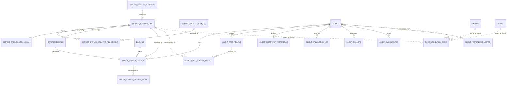

---
codeanchors:
  - backend/modules/
---

Part 7 of 8 · [02 — Product Requirements Document (PRD)](02-prd.md) · [Previous](02-prd-part-6.md) · [Next](02-prd-part-8.md)

#### Interaction Tracking & Favorites
| ID | Requirement | Priority |
|----|-------------|----------|
| INT-1 | Every branch view, barber view, catalog item view, search query, and favorite action is recorded. | ✅ Must |
| INT-2 | The `context` JSON captures the active universe, applied filters, search query, and screen name. | ✅ Must |
| INT-3 | Clients can favorite/unfavorite branches, barbers, brands, and catalog items. Favorites are **strictly private**. | ✅ Must |
| INT-4 | Clients can save filter configurations for quick reuse. | 🟢 Should |
| INT-5 | A nightly batch job processes interaction logs to update preference vectors and recommendation edges. | 🟢 Should |

#### Discovery Filters & Recommendations
| ID | Requirement | Priority |
|----|-------------|----------|
| REC-1 | The discovery API accepts new filters: `catalog_item_ids`, `available_now`, `price_range`, `rating_min`, `face_shape_compatible`. | ✅ Must |
| REC-2 | Discovery results ranked by composite score: proximity + preference match + trending weight. | 🟢 Should |
| REC-3 | Recommendation edges populated by favorites, booking history, catalog item similarity, face-shape compatibility. | 🟢 Should |
| REC-4 | Adaptive preference tuning: consistent filter patterns adjust the client's vector automatically. | 🔭 Later |
| REC-5 | Search surfaces results based on catalog item tags and face-shape compatibility. | 🟢 Should |

### 12.6 Relationship Diagram

