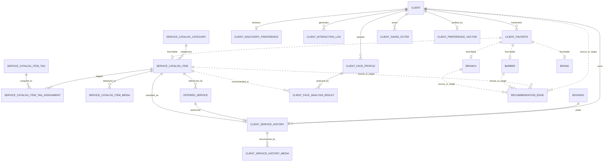

---
codeanchors:
  - backend/modules/
---

Part 12 of 13 · [06 — Entity Model (Abstract)](06-entity-model-abstract.md) · [Previous](06-entity-model-abstract-part-11.md) · [Next](06-entity-model-abstract-part-13.md)

## 7. Client Intelligence Relationship Diagram

> Dashed lines indicate polymorphic relations.

> This diagram extends the core relationship diagram in §3. The 15 new entities span 5 modules: ServiceCatalog, ClientHistory, ClientFaceProfile, ClientInteraction, Recommendation.

---
