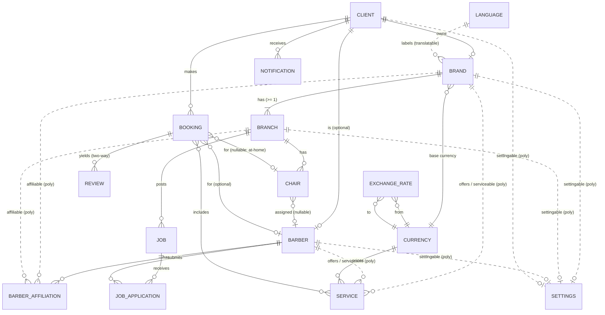

---
codeanchors:
  - backend/modules/
---

Part 6 of 13 · [06 — Entity Model (Abstract)](06-entity-model-abstract.md) · [Previous](06-entity-model-abstract-part-5.md) · [Next](06-entity-model-abstract-part-7.md)

## 3. Abstract relationship view

> Relationships only (no attributes) — the *shape* of the model. Dashed links marked **(poly)** are **polymorphic**: one end can point at more than one kind of entity (explained in §4).

> If your Markdown viewer doesn't render Mermaid, read the diagram as the relationship list spelled out in §4 and in `04-house-rules.md`.

---
