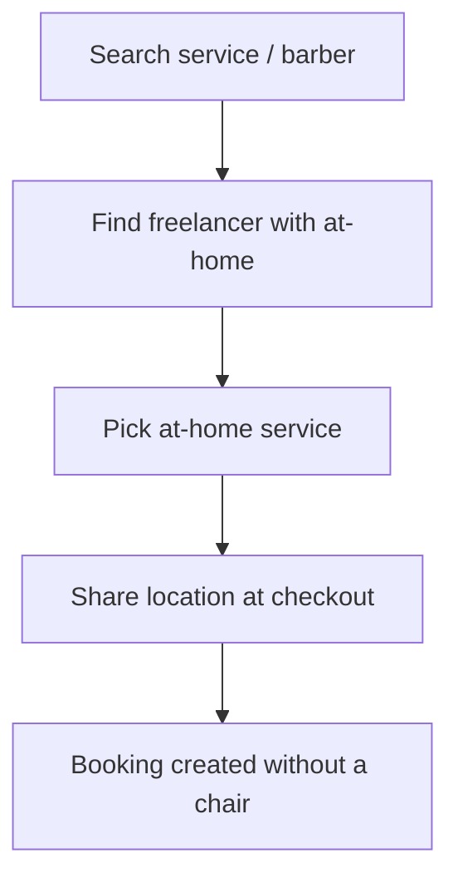
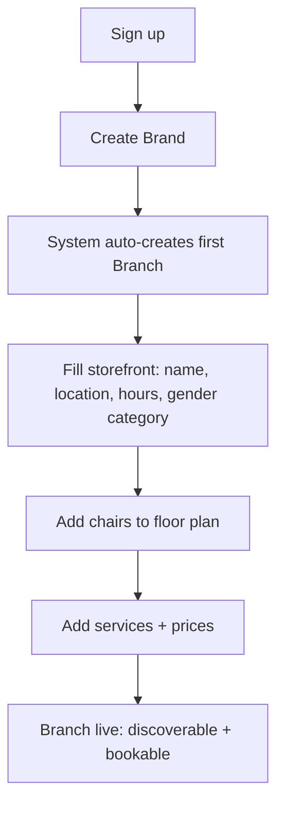
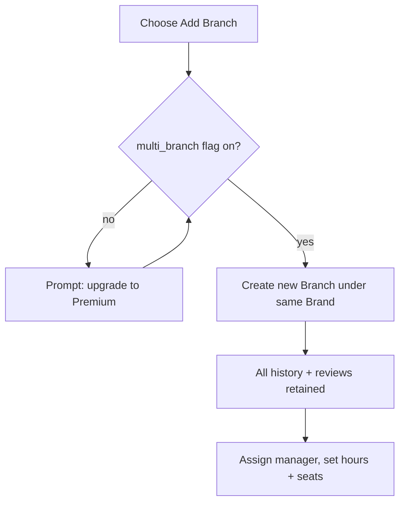

---
codeanchors:
  - backend/modules/
---

Part 2 of 4 · [07 — User Flows](07-user-flows.md) · [Previous](07-user-flows.md) · [Next](07-user-flows-part-3.md)

## 3. Client — book an at‑home barber

1. Client finds a **freelance** barber offering **at‑home** (via search; freelancers surface even without a fixed address) `[search]`.
2. Client picks an **at‑home** service `[D6]`.
3. At checkout the client provides a GPS map pin plus street, building, and unit/apartment text instead of choosing a chair `[L1]`.
4. Booking is created **without a chair**, carrying the client's location.

---

## 4. Owner — onboarding (Branch‑First)

1. Owner signs up → creates a **Brand**.
2. System **auto‑creates the first Branch** `[A1/A2]`.
3. Owner fills the **storefront**: bilingual name, address/coordinates, hours, **gender category** `[A5]`.
4. Owner adds **chairs** with positions for the floor plan `[B1]`.
5. Owner adds **services** with prices in the base currency `[D1/D2/D3]`.
6. Branch is now discoverable and bookable.

---

## 5. Owner — expand from one branch to many (the non‑event)

1. Owner chooses **Add Branch**.
2. System checks the **multi‑branch** flag `[A3/I2]`:
   - off → prompt to **upgrade to Premium**;
   - on → continue.
3. New Branch is created **under the same Brand** — **all history/reviews stay** `[A4]`.
4. Owner assigns a **Manager** and sets that branch's hours/seats.

---
