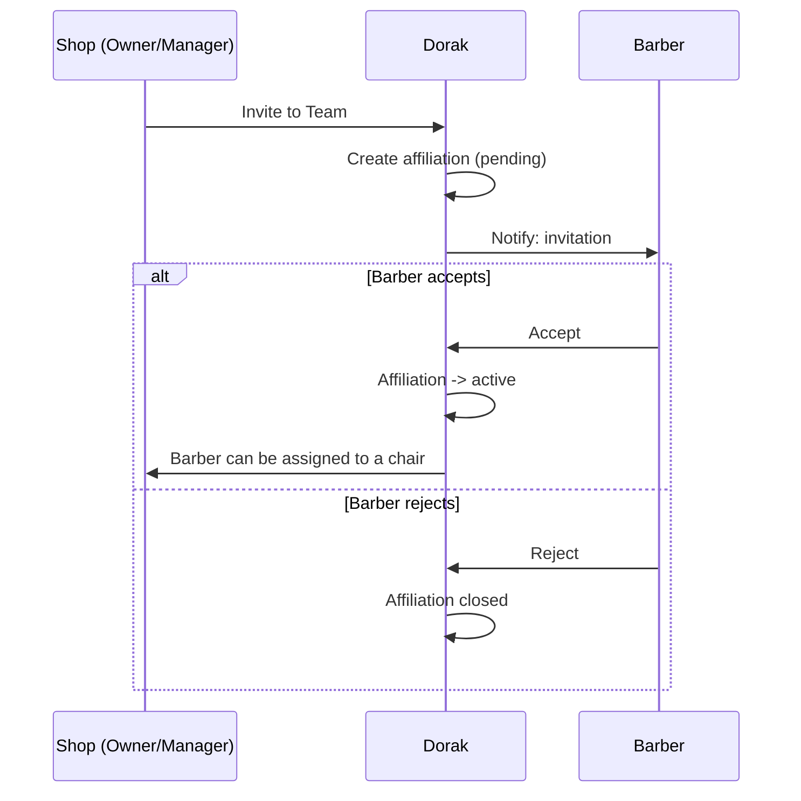

---
codeanchors:
  - backend/modules/
---

Part 3 of 4 · [07 — User Flows](07-user-flows.md) · [Previous](07-user-flows-part-2.md) · [Next](07-user-flows-part-4.md)

## 6. Barber — onboard as a standalone professional

1. Barber signs up → builds **profile, portfolio, bio**.
2. Barber adds **their own services** (with prices) `[D1]`.
3. Barber optionally marks **freelancer** + **at‑home** with a travel radius `[C7]`.
4. Barber is now discoverable independently `[search]`, with **no shop required** `[C2]`.

---

## 7. Shop invites a barber → affiliation

1. Manager/Owner opens a barber's profile → **Invite to Team**.
2. An **Affiliation** is created with status **pending** `[G4/G5]`.
3. Barber receives the invite → **accepts** or **rejects** `[G4]`.
   - accept → affiliation **active**; barber can be assigned to a **chair** `[C3/C6]`;
   - reject → affiliation closed; nothing else changes.

---
