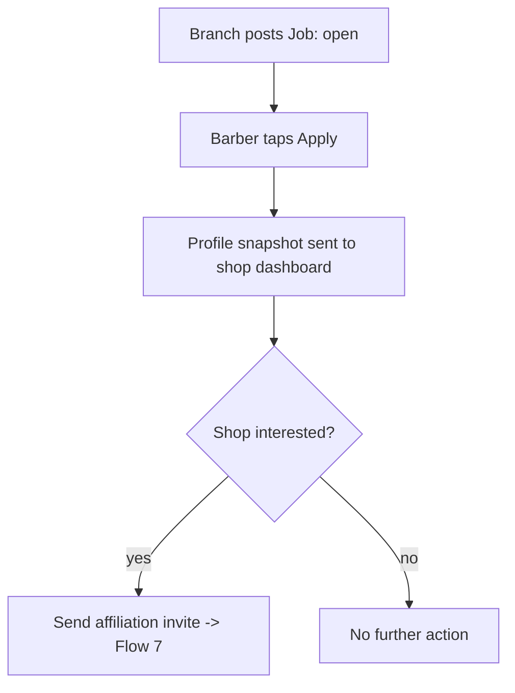
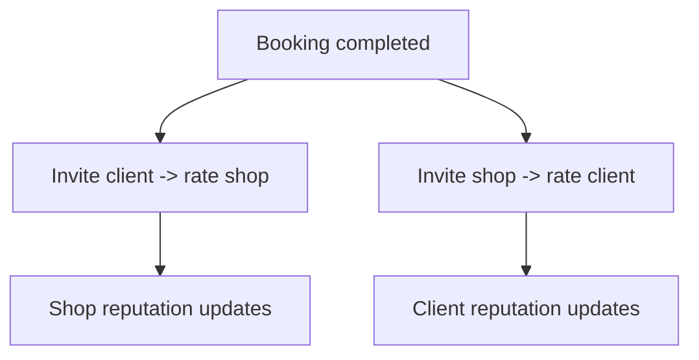
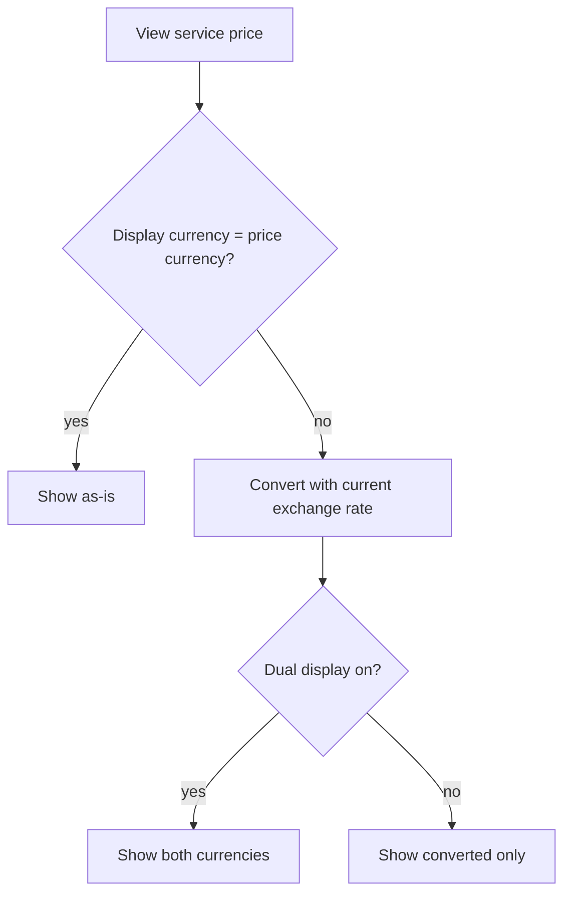

Part 4 of 4 · [07 — User Flows](07-user-flows.md) · [Previous](07-user-flows-part-3.md)

## 8. Barber applies to a posted job (simple, no ATS)

1. Branch posts a **Job** (open) — needs the **job board** flag `[G1/I2]`.
2. Barber sees it and taps **Apply** `[G3]`.
3. System sends a **profile snapshot** to the shop's dashboard `[G3]`.
4. Shop reviews the snapshot; if interested, it may **invite** the barber (Flow 7).

---

## 9. After the appointment — two‑way review

1. A booking becomes **completed** `[F1]`.
2. App invites **both** sides to review: client → shop, shop → client `[F1]`.
3. Ratings update the shop's and the client's reputation `[F3]`.
4. If the appointment **didn't happen** (no‑show/cancelled), **no review** is allowed `[F2]`.
5. A flagged dispute keeps the review unpublished for a 48-hour admin review.

---

## 10. Price display (currency on the fly)

1. Client views a service.
2. System reads the price + its currency, and the brand's **base currency** `[D2/D3]`.
3. If the client's display currency differs, system **converts using the current exchange rate** `[D4]`.
4. If the shop enabled **dual display**, show **both** `[D5]`.

