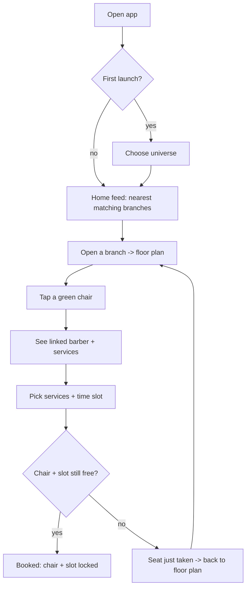

# 07 — User Flows

> **Step‑by‑step interaction flows.** Where stories in `03-persona-journeys.md` show *why*, these show *what happens, step by step*. Diagrams are abstract (flow/sequence), not code. Rules referenced as `[E1]` etc. point to `04-house-rules.md`.

---

## 1. Client — discover & book a chair

1. Client opens the app and (first time) chooses a **Universe** `[J3]`.
2. Home feed shows the **nearest** matching branches `[J4]`.
3. Client opens a branch → sees the **visual floor plan** (green = free now) `[B2]`.
4. Client taps a **green** chair → sees the **linked barber** (if any) + relevant **services** `[B4/B5]`.
5. Client picks service(s); price shows in their currency, optionally dual `[D4/D5]`.
6. Client picks a **time slot** and confirms.
7. System attempts to lock **chair + slot**:
   - if free → **booked**, chair + slot locked to client `[E2]`;
   - if just taken → **"this seat was just taken"** `[E1]`, return to step 3.

---

## 2. Client — book a specific barber (preference‑first)

Some clients follow a barber rather than a chair.

1. Client **searches the barber by name**, or opens their profile from a previous visit.
2. Client sees where the barber is **working** (which branch/chair) and/or their **at‑home** option `[E3]`.
3. Client picks the barber's service + slot.
4. System books **by barber** (and the chair, if at a shop) with the same no‑double‑booking check `[E1]`.

---

## Continued in

- [Part 2: 3. Client — book an at‑home barber](07-user-flows-part-2.md)
- [Part 3: 6. Barber — onboard as a standalone professional](07-user-flows-part-3.md)
- [Part 4: 8. Barber applies to a posted job (simple, no ATS)](07-user-flows-part-4.md)
