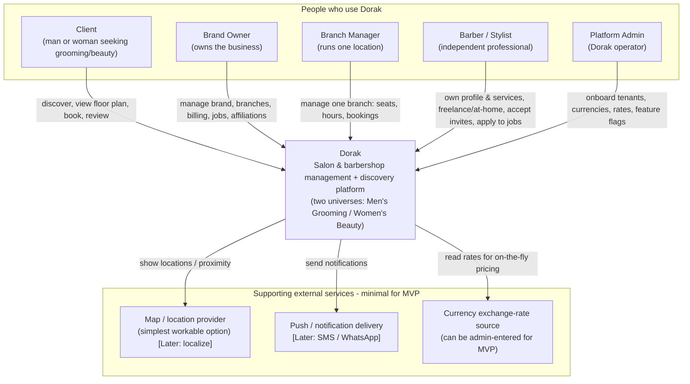

# 09 — C4 Context (Level 1)

> **The system as one box**, and everyone/everything that touches it. No internals here — that's `10-c4-containers.md`. This follows the **C4 model** (Context → Containers). Diagram is abstract; **no code**.

---

## The one‑box view

Dorak is a single system to its users. People interact with it; a few external services support it (kept minimal for MVP).

---

## Actors (who uses it)

- **Client** — discovers nearby shops in their chosen **universe**, books against the **visual floor plan** (or by barber / at‑home), and leaves **two‑way reviews**.
- **Brand Owner** — manages the whole **Brand**: all branches, billing/feature flags, managers, jobs, and barber affiliations.
- **Branch Manager** — manages **one Branch**: its chairs, hours, and bookings — deep but local.
- **Barber / Stylist** — a **standalone** professional: owns profile/portfolio/services, works freelance/at‑home and/or for shops, accepts invites, applies to jobs.
- **Platform Admin** — operates the platform: onboards tenants, maintains **currencies and exchange rates**, and controls **feature flags**.

## Continued in

- [Part 2: Supporting external services (intentionally light for MVP)](09-c4-context-part-2.md)
