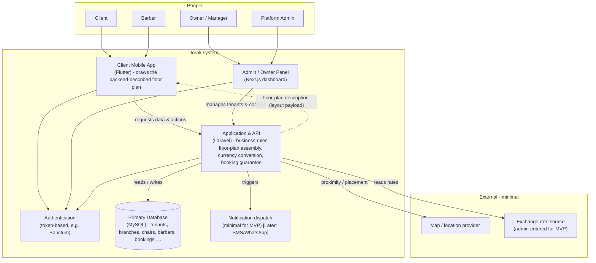

# 10 — C4 Containers (Level 2)

> **Inside the one box.** The major moving parts (the "containers" in C4 terms) and how they talk. This records the **intended technical context** for shared understanding — but contains **no code, no schema, no configuration.** Versions/tools are the owner's choices and should be confirmed at build time.

---

## The container view

---

## Continued in

- [Part 2: The containers (plain English)](10-c4-containers-part-2.md)
- [Part 3: The signature data flow — Backend‑Driven UI](10-c4-containers-part-3.md)
