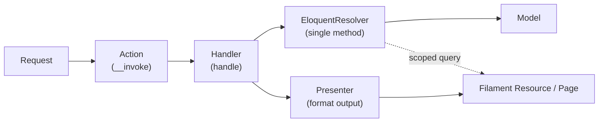

Part 2 of 19 · [11 — Backend Architecture (C4 Level 3: Components & Conventions)](11-backend-architecture.md) · [Previous](11-backend-architecture.md) · [Next](11-backend-architecture-part-3.md)

## 2. The Action → Handler → EloquentResolver pattern (the core)

**There is no Controller, no Service layer, and no Repository.** Those three become god‑classes as the app grows. Instead, each unit of work is **three single‑purpose, single‑method classes**, named by the **action** (never by the entity + a generic verb):

| Old way (avoided) | This codebase |
|---|---|
| `BookingController@index` | `ListAllBookingsAction` (invokable) |
| `BookingController@store` | `CreateBookingAction` |
| `BookingService` (many methods) | one `…Handler` per action, single method `handle()` |
| `BookingRepository` (many methods) | one `…EloquentResolver` per action, single Eloquent method |

### The three classes
- **Action** — a Laravel **invokable single‑action controller**, but named and filed as an *Action* and never called "Controller." It has Laravel's `__invoke`, stays thin, and does only HTTP concerns: receive the validated request, call its Handler, return via a Presenter/Resource.
- **Handler** — the **logic layer**. Same base name as its action, suffix `Handler`, exactly **one method: `handle()`**. All business logic for that one action lives here; it calls the EloquentResolver for data and enforces the relevant `04` house rules.
- **EloquentResolver** — the **only place Eloquent runs**. Same base name, suffix `EloquentResolver`, exactly **one method**. It contains nothing but the Eloquent operation for that action.

### Why
One action = one HTTP responsibility = one method in each layer. Nothing accumulates methods, so no file grows unbounded. A failed feature is three small files, not a tangled service.

### Worked example — `modules/Booking/`
- `ListAllBookingsAction` → `ListAllBookingsHandler@handle` → `ListAllBookingsEloquentResolver` → `BookingModel`
- `CreateBookingAction` → `CreateBookingHandler@handle` → `CreateBookingEloquentResolver` → `BookingModel`
  - the **no‑double‑booking** guarantee (`04` E1 / `08` EC‑1) lives in this handler + resolver, using the `concurrency-safety` skill's locking‑in‑a‑transaction pattern.

---

## 3. Layering (not strict hexagonal)

Data flows **down**; output formats on the way back up.

**Key rule — resolvers own ALL query logic.** Filament resources never write raw Eloquent. If a resource needs scoped data (e.g. a client panel showing only the current user's bookings), it calls a resolver method, not an inline query. Presenters format for output; Filament reads from presenters for infolists and from resolvers for tables.

---
