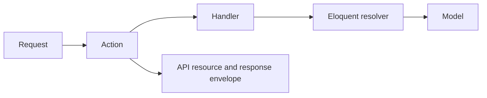

---
codeanchors:
  - backend/modules/
---

# 11 — Backend architecture (C4 level 3)

How the Laravel code is laid out. The rules for writing it are in the [backend guide](../AGENTS.md); business rules are
in the [house rules](04-house-rules.md). The containers around it are in [level 2](10-c4-containers.md).

## Modules

The code is a modular monolith under `modules/{Name}/`, sharing one database and one request cycle. There is no `app/`
or `routes/` directory. Every provider is listed by name in `bootstrap/providers.php`; nothing is discovered. Module
providers extend `Modules\Core\Providers\BaseModuleServiceProvider`, which loads whichever of these exist: config,
console, web and API routes, migrations, translations and views. API routes are mounted at `/api/v1`. `Modules\Core`
holds shared configuration and infrastructure.

A module has only the folders it needs:

| Folder | Holds |
|---|---|
| `Http/Actions/` | Invokable entry points: HTTP concerns only. There are no controllers |
| `Http/Requests/`, `Http/Resources/` | Validation; response shapes |
| `Handlers/` | The logic for one action, in `handle()` |
| `CQRS/` | Command and query objects passed to handlers |
| `Eloquent/Resolvers/` | The data access for one action. A few older modules use `Repositories/` |
| `Queries/`, `Services/` | Query and domain logic shared by several handlers (see BD-16) |
| `Models/`, `Database/` | Eloquent models; migrations, factories, seeders |
| `Enums/`, `Constants/`, `ValuesObjects/` | Backed enums, named constants, typed values |
| `Policies/` | Authorization |
| `Routes/`, `Lang/` | Routes; English and Arabic strings |

## Request flow

One unit of work has one action, one handler and its resolver, named for the action (`CreateBookingAction`,
`CreateBookingHandler`, `CreateBookingEloquentResolver`), so that no class gathers unrelated methods. Responses use
the [standard envelope](api-response-standard.md).

## Surfaces and engines

The Laravel app serves only the API. The Next.js dashboard is the web surface for every dashboard actor, and the
Flutter apps use the same API. The database is MySQL ([testing strategy](../../docs/architecture/testing-strategy.md));
an earlier PostgreSQL and pgvector design for recommendations was not built. Face analysis uses `laravel/ai`.
