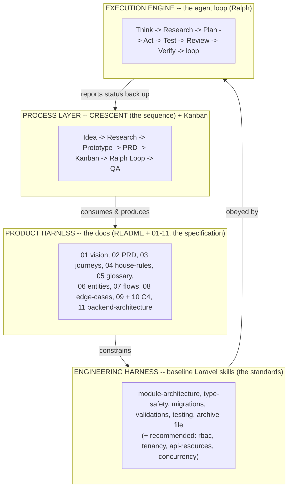

# PROCESS — How CRESCENT, the Loop, and the Laravel Baseline Skills plug into the docs

> **The gap this fills.** The `docs/` folder is a *specification* — it says **what** to build and **why**, and freezes the **laws**. It does not say **how to execute** that spec reliably with an AI agent. Your three new ideas supply exactly the three missing pieces:
>
> 1. **Harness engineering** → the *static scaffolding* the agent reads (docs + skills + rules).
> 2. **Loop engineering** → the *dynamic engine* that iterates: Think → Research → Plan → Act → Test → Review → Verify.
> 3. **CRESCENT** → the *named sequence* that orders everything: Idea → Research → Prototype → PRD → Kanban → Ralph Loop → QA.
>
> This document is the wiring diagram that connects all three to the existing docs. It is the answer to *"how do I introduce these with our README / 01–11?"*

---

## 1. The mental model — four layers of one harness

Think of it as a stack. The product spec sits in the middle; the process drives it from above; the engineering standards constrain it from below; the loop is the motor.

- **CRESCENT** doesn't replace the docs — it **reads and rewrites** them (early phases) and **verifies against** them (late phases).
- **Baseline skills** don't restate the docs — they **enforce** them in code. Every skill **cites** the docs it implements.
- **The loop** runs *inside* CRESCENT's phase 6, governed by the skills and the docs.

---

## Continued in

- [Part 2: 2. The three wiring principles (the whole idea in three sent](process-part-2.md)
- [Part 3: 5. How the baseline Laravel skills attach to the docs](process-part-3.md)
- [Part 4: 7. Where this physically lives (folder layout)](process-part-4.md)
