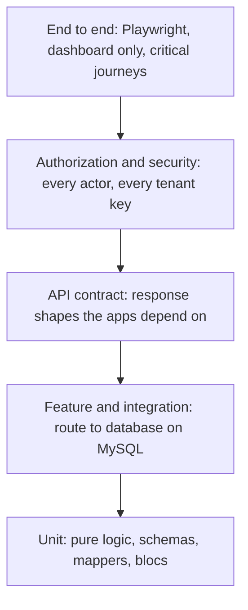
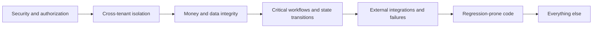
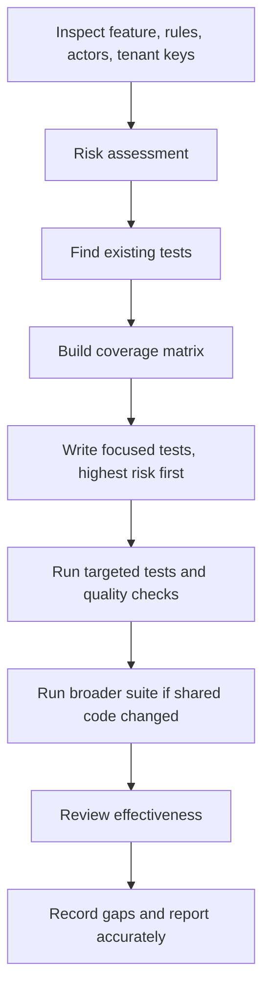

# Testing strategy

Routes: [documentation graph](../index.md) · [architecture](architecture.md) ·
[test-engineering skill](../../.claude/skills/test-engineering/SKILL.md).

This page explains why the repository is tested the way it is. The operational rules, checklists and
the coverage-matrix format live in the
[test-engineering skill](../../.claude/skills/test-engineering/SKILL.md), which is the single source
of testing instructions for developers and AI agents. This page does not repeat them; when the two
differ, the skill wins. Gate commands stay in the task executor's
[gates reference](../../.claude/skills/monorepo-task-executor/references/gates.md).

## Objectives

- Catch authorization and cross-tenant leaks before they ship; a multi-tenant barbershop platform
  holds other businesses' bookings, staff and money.
- Keep the API contract stable for the dashboard and the three mobile apps.
- Prove business rules and state transitions, including what must not change.
- Report coverage honestly: what was written, run, measured and left unproven.

## Test pyramid

Prefer the lowest layer that proves the behaviour. The wide base is cheap and fast; the top is
reserved for journeys that cross the real stack.

## Tools by subsystem

| Subsystem | Framework | Where | Gate |
| --- | --- | --- | --- |
| Backend | Pest 3 on PHPUnit 11, MySQL `dorak_test` | `backend/tests/{Unit,Integration,Feature}` | `vendor/bin/pint --test`, `composer test` |
| Dashboard | Vitest (Node environment), Playwright | `frontend/web/dashboard/tests` | lint, typecheck, `npm test`, build, Playwright |
| Mobile | `flutter test` via melos | `frontend/mobile/**/test` | `dart run melos run verify` |

## Risk-based prioritisation

Effort follows risk, not test count. One test proving that a manager cannot reach another branch is
worth more than many assertions of a 200.

## Security and cross-tenant testing

Each changed route is checked per actor (admin, brand owner, manager, barber, client, guest), derived
from the code and policies and never invented. Tenant keys in the URL, body and filters are swapped
to another tenant's values, and the database is asserted afterwards, not only the status. The brand
owner is a client account with a dashboard capability, not a role flag
([ADR 0001](../adr/0001-brand-owner-as-client.md)). The skill holds the procedure.

## Test quality

A test is judged by whether it would fail if the feature regressed: persisted state, forbidden state
changes, boundary status, side effects and failure behaviour. For high-risk rules the skill asks for
a deliberate local break (or a mutation run where approved) to prove the test can fail.

## Coverage and mutation testing

On the date of writing there is no coverage driver on the development machine, `infection/infection`
is not installed, Pest's mutation plugin is present but unused, and `phpunit.xml` points its coverage
source at a directory that does not exist. Coverage and mutation are therefore documented but not
gates. Enabling them is a proposal that needs approval (fix the source path, add a driver, trial
`pest --mutate` on one critical service). A percentage is never proof of quality. The skill lists the
commands that re-check these facts.

## Database compatibility

Backend tests run on MySQL (`dorak_test`) only, locally and in CI, the same engine as production, so
engine behaviour (locks, unique indexes, transactions, DDL) is exercised. SQLite is not a supported test
driver: `phpunit.xml` forces MySQL and `dorak_test`, and `Tests\Support\TestDatabaseGuard` stops the run
before `migrate:fresh` if the driver or database name differs, so the development database cannot be
wiped by a test run. A lock-order test asserts the real `FOR UPDATE` statements; true concurrency (double booking) needs
overlapping connections and stays marked unverified until such a test exists.

## Workflow

The skill expands this into 14 steps and a reporting vocabulary that keeps tests implemented, tests
executed, coverage measured, mutation performed, known gaps and unverified behaviour separate.

## Coverage matrix

Each feature carries a matrix with 12 columns: feature, business rules, actors, tenant boundaries,
positive, negative and failure scenarios, persistence and side effects, existing tests, missing
coverage, risk and verification status. The format and statuses are in
[the skill's reference](../../.claude/skills/test-engineering/references/coverage-matrix.md).

## CI and quality gates

| Where | What runs today |
| --- | --- |
| GitHub Actions `backend-ci.yml` | migration guard, `composer validate`, PHP syntax check, `php artisan test` on MySQL 8 (coverage off) |
| Local hooks (`.husky`) | commit message format; dashboard lint and typecheck on staged dashboard files |
| Task executor | the gate order in `gates.md`, including Pint, Pest, dashboard checks, Playwright and `melos verify` |

Recommended future improvements, not part of this work: a coverage-capable CI job (after the
`phpunit.xml` source path is fixed and a driver chosen), a scheduled mutation run on critical
services, dashboard and mobile CI jobs, and a check that rejects duplicate global Pest helper names.

## How to use the skill

- Developers and agents writing, reviewing or expanding tests, fixing a bug with a regression test, or
  touching security-sensitive code open the
  [test-engineering skill](../../.claude/skills/test-engineering/SKILL.md) first.
- The task executor loads it at its implementation step through `gates.md`; the council judges
  feasibility, the skill judges test quality, and neither duplicates the other.
