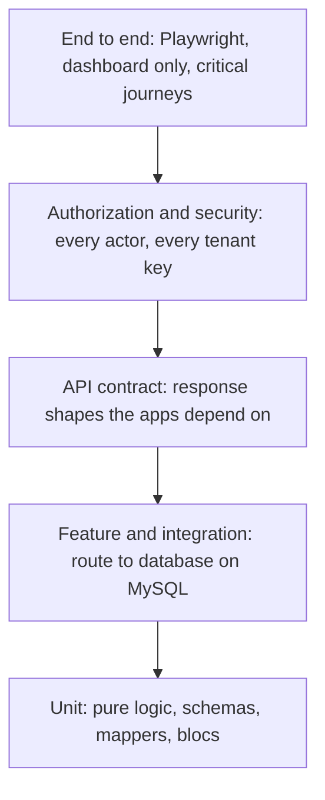
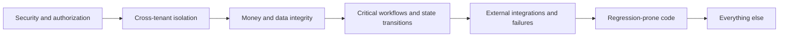
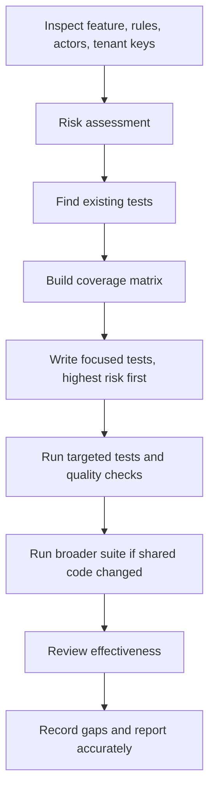

# Testing strategy

Routes: [documentation graph](../index.md) · [architecture](architecture.md) ·
[test-engineering skill](../../.claude/skills/test-engineering/SKILL.md).

This page explains why the repository is tested the way it is. The operational rules, checklists and
the coverage-matrix format live in the
[test-engineering skill](../../.claude/skills/test-engineering/SKILL.md), which is the single source
of testing instructions for developers and AI agents. This page does not repeat them; when the two
differ, the skill wins. Gate commands stay in the task executor's
[gates reference](../../.claude/skills/monorepo-task-executor/references/gates.md).

## Objectives

- Catch authorization and cross-tenant leaks before they ship; a multi-tenant barbershop platform
  holds other businesses' bookings, staff and money.
- Keep the API contract stable for the dashboard and the three mobile apps.
- Prove business rules and state transitions, including what must not change.
- Report coverage honestly: what was written, run, measured and left unproven.

## Test pyramid

Prefer the lowest layer that proves the behaviour. The wide base is cheap and fast; the top is
reserved for journeys that cross the real stack.

## Tools by subsystem

| Subsystem | Framework | Where | Gate |
| --- | --- | --- | --- |
| Backend | Pest 3 on PHPUnit 11, MySQL `dorak_test` | `backend/tests/{Unit,Integration,Feature}` | `vendor/bin/pint --test`, `composer test` |
| Dashboard | Vitest (Node environment), Playwright | `frontend/web/dashboard/tests` | lint, typecheck, `npm test`, build, Playwright |
| Mobile | `flutter test` via melos | `frontend/mobile/**/test` | `dart run melos run verify` |

## Risk-based prioritisation

Effort follows risk, not test count. One test proving that a manager cannot reach another branch is
worth more than many assertions of a 200.

## Security and cross-tenant testing

Each changed route is checked per actor (admin, brand owner, manager, barber, client, guest), derived
from the code and policies and never invented. Tenant keys in the URL, body and filters are swapped
to another tenant's values, and the database is asserted afterwards, not only the status. The brand
owner is a client account with a dashboard capability, not a role flag
([ADR 0001](../adr/0001-brand-owner-as-client.md)). The skill holds the procedure.

Two generated route matrices read the router itself, so a new route is covered the moment it exists.
`DashboardAdminRouteAuthorizationTest` sends every `/dashboard/admin` route anonymously (401) and as an
owner, manager and barber (403). `DashboardCrossTenantRouteTest` creates one of every record an ID route
can name inside owner B's brand, then sends every other tenant-facing dashboard ID route as owner A and
as a manager of owner A, with a body that passes validation so the tenant check is reached. It expects
403 or 404 and digests twelve tenant tables before and after to prove nothing changed. A control test
runs the same routes as owner B and fails on any 401, 403, 404, 422 or 5xx, so a fixture that cannot
reach the code under test cannot make the isolation check pass vacuously. A route parameter with no
fixture fails the test. When a route gains a body rule, add its valid body to `tenantPayload`.

## Test quality

A test is judged by whether it would fail if the feature regressed: persisted state, forbidden state
changes, boundary status, side effects and failure behaviour. For high-risk rules the skill asks for
a deliberate local break (or a mutation run where approved) to prove the test can fail.

## Cross-stack drift guards (D2)

`backend/tests/Fixtures/wire-enums.json` lists the cases of the backend enums the clients mirror. The Pest test `tests/Feature/Core/WireEnumFixtureTest.php` keeps it equal to the backend (regenerate with `UPDATE_WIRE_ENUMS=1 vendor/bin/pest tests/Feature/Core/WireEnumFixtureTest.php`). The dashboard's `tests/enums/wire-enum-fixture.test.ts` and the mobile `packages/core/test/wire_enum_fixture_test.dart` fail when their enums no longer match it, so a new or renamed backend case fails in all three stacks. Text drift is guarded separately: the dashboard's `tests/locales/dictionaries.constant.test.ts` and the mobile `packages/localization/test/localization_test.dart` check English and Arabic key parity and placeholders, and `tests/Feature/Core/ValidationAttributeNamesTest.php` guards the Arabic validation names. To cover another enum, add it to `wireEnumCases()` and to the two client mirrors lists.

## Realtime

A change to broadcasting, channel rules or the Reverb config is also checked against a real
local Reverb server with a queue worker ([runbook](../waves/runbook.md#local-realtime-reverb-and-a-queue-worker)):
who may join, who receives each event, and how many times. Channel authorization tests and faked
events can't show that a client can connect at all; Reverb once refused every connection while
those tests passed (BG-51).

## Language guards (2026-11-23)

- **Terminology:** user-facing Arabic never calls the stylist "الحلاق" (the trade "الحلاقة" is allowed). Guards: `tests/Feature/Core/ArabicTerminologyTest.php` (backend `Lang/ar`), `tests/locales/dictionaries.constant.test.ts` (dashboard) and `packages/localization/test/localization_test.dart` (mobile). Standard: [localization of machine keys](localization-of-machine-keys.md).
- **Duplicate ARB keys:** the same mobile test counts raw top-level keys, because `jsonDecode` keeps the last duplicate silently.
- **Stored-language fallback (C1):** `tests/Feature/Core/StoredLocaleWriteRoutesTest.php` fails when a dashboard write route lacks `ApplyPreferredLocaleMiddleware`, and checks owner and barber write routes answer in Arabic without `Accept-Language`.
- **Allowed-path guard tests (C4):** a test that expects "no exception" first proves the guard still refuses a bad case (`DashboardWriteGuardTest`, `ProductionDeliveryGuardTest`), so a guard that never throws cannot pass.

## Coverage and mutation testing

On the date of writing there is no coverage driver on the development machine, `infection/infection`
is not installed, Pest's mutation plugin is present but unused, and `phpunit.xml` points its coverage
source at a directory that does not exist. Coverage and mutation are therefore documented but not
gates. Enabling them is a proposal that needs approval (fix the source path, add a driver, trial
`pest --mutate` on one critical service). A percentage is never proof of quality. The skill lists the
commands that re-check these facts.

## Database compatibility

Backend tests run on MySQL (`dorak_test`) only, locally and in CI, the same engine as production, so
engine behaviour (locks, unique indexes, transactions, DDL) is exercised. SQLite is not a supported test driver.

### Single test database policy (permanent)

1. `dorak_test` is the only automated-test database.
2. Automated tests run sequentially.
3. Parallel, database-per-worker testing is prohibited (`--parallel` creates `dorak_test_test_<n>` databases).
4. The database is recreated clean before each complete run: `composer test` and `composer test:concurrency` call `composer test:reset` (`backend/scripts/reset_test_database.php`), and CI runs the same script first.
5. Destructive test operations (drop, create, `migrate:fresh`) apply only to `dorak_test`.
6. Development and production databases must never be affected by automated test setup.
7. Integration tests run on **MySQL 8.4** only, locally and in CI (`mysql:8.4`, 127.0.0.1:3307). MariaDB and every other version are refused with no fallback: the guard reads `select version()`.
8. Any change to this policy requires explicit approval.

Local MySQL 8.4: `composer test:db:up` starts `backend/docker-compose.test.yml` (database `dorak_test`, loopback port 3307, data in memory) and `composer test:db:down` stops only that container. `phpunit.xml` forces the whole connection, so no `.env.testing` setup is needed and it cannot redirect the suite; with the container stopped, tests stop with an instruction to start it. Development databases and their configuration are never used or modified.

Destructive commands: `migrate:fresh`, `migrate:refresh`, `migrate:reset` and `db:wipe` refuse to run in production **and** whenever the default connection is not a local database (remote host, or no host and no socket), whatever `APP_ENV` says. Local development wipes (`composer restart-local`) stay available. There is no production wipe script.

Enforcement: `phpunit.xml` forces MySQL and `dorak_test`; `Tests\Support\TestDatabaseGuard` runs right after the app boots and refuses a parallel worker, a wrong `APP_ENV`, driver, server version, database name, host (a unix socket is refused), port (only 3307) or user before anything is created or migrated. It is an allow-list of configuration, not proof of what the server holds, so never name a development database `dorak_test`. Lock-order tests assert the real `FOR UPDATE` statements; `tests/Concurrency` (group `concurrency`, `composer test:concurrency`, run by CI after the default suite) proves them with separate PHP processes and MySQL sessions against the same `dorak_test`. Those tests commit rows, so the default run excludes them and the schema is rebuilt after every concurrency test; the lock proofs wait on the server's process list instead of sleeping, and the apply race has a variant with the unique index dropped so the lock alone must serialize it. The Playwright suite refuses to run unless `DB_DATABASE=dorak_test`.

## Shared test defaults

`backend/tests/TestCase.php` overrides `json()` so that a `POST /api/v1/bookings` without an `Idempotency-Key` gets a fresh UUID (the header is required, BG-9). A test of the missing-key case sets `$this->omitBookingIdempotencyKey = true`; a test of replays sends its own key with `withHeaders`. Add a default of this kind only for a header or field that is required but irrelevant to most tests, and cover the required case with its own test.

## Workflow

The skill expands this into 14 steps and a reporting vocabulary that keeps tests implemented, tests
executed, coverage measured, mutation performed, known gaps and unverified behaviour separate.

## Coverage matrix

Each feature carries a matrix with 12 columns: feature, business rules, actors, tenant boundaries,
positive, negative and failure scenarios, persistence and side effects, existing tests, missing
coverage, risk and verification status. The format and statuses are in
[the skill's reference](../../.claude/skills/test-engineering/references/coverage-matrix.md).

## CI and quality gates

| Where | What runs today |
| --- | --- |
| GitHub Actions `backend-ci.yml` | migration guard, `composer validate`, Pint, PHP syntax check, `php artisan test` and the concurrency group on MySQL 8.4 |
| GitHub Actions `dashboard-ci.yml` | lint, typecheck, Vitest, build (no Playwright) |
| GitHub Actions `mobile-ci.yml` | analyze and tests, and app builds (the workflow decides when builds run) |
| Local hooks (`.husky`) | commit message format; dashboard lint and typecheck on staged dashboard files; before a push that changes `backend/`: Pint, migration guard and Pest |
| Task executor | the gate order in `gates.md`, including Pint, Pest, dashboard checks, Playwright and `melos verify` |

Recommended future improvements, not part of this work: a coverage-capable CI job (after the
`phpunit.xml` source path is fixed and a driver chosen), a scheduled mutation run on critical
services, and a check that rejects duplicate global Pest helper names.

## How to use the skill

- Developers and agents writing, reviewing or expanding tests, fixing a bug with a regression test, or
  touching security-sensitive code open the
  [test-engineering skill](../../.claude/skills/test-engineering/SKILL.md) first.
- The task executor loads it at its implementation step through `gates.md`; the skill judges test quality.

## Process-based concurrency tests

A race between two requests cannot be tested inside the default per-test transaction, because both requests would share one database session. The `concurrency` group (`backend/tests/Concurrency/`, `composer test:concurrency`) starts each request in its own PHP process with its own MySQL session through `backend/tests/Support/concurrency-helpers.php` and `concurrency-worker.php`, and rebuilds the schema after every test. Prove a lock with blocked-then-refused (a third session holds the row, the request must visibly wait, then refuse on the new state); a plain race only proves the outcome. A deadlock hunt repeats the race for several rounds (`BOOKING_RACE_ROUNDS`). Method, current coverage and the open cases: [booking concurrency, test coverage](../booking-concurrency/07-test-coverage.md).

Assert the end state (one row, one live token, one default), not only status codes. Every change to locking, uniqueness, token rotation, one-time codes or idempotency adds such a test; the open list is backlog TS-8 and the findings are in [write paths outside booking](../booking-concurrency/09-write-path-audit.md).
