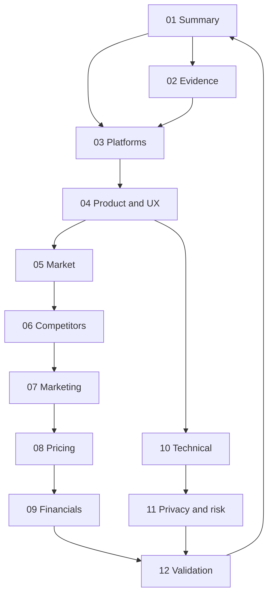

---
codeanchors:
  - docs/competitor-analysis/
---

# Toptalla (توب طلة): competitor study

Routes: [competitor analysis](../index.md) · [documentation graph](../../index.md)

An outside-in study of Toptalla, a Saudi-based salon operations system and booking marketplace that also shows a public offer in Syria. Review date: 18 November 2026. It is built on public sources and a sample of the web experience; it is not a security audit, a financial review, or a test of every feature on real devices.

The study was originally one Arabic document. It is now in English, split into twelve files, each with one idea and scope. The Arabic original was removed after the translation was verified against it. Start with the summary; the other files are in reading order.

## Files

| # | File | Scope |
|---|---|---|
| 01 | [Executive summary](01-executive-summary.md) | The one-page answer and a router to every topic |
| 02 | [Company and evidence](02-company-and-evidence.md) | Who is behind it, product evolution, source reliability |
| 03 | [Platforms and availability](03-platforms-and-availability.md) | Web, Android, iOS, macOS/Vision, desktop, and what was not verified |
| 04 | [Product and user experience](04-product-and-user-experience.md) | What each party gets, the web sample, published case studies |
| 05 | [Market and geography](05-market-and-geography.md) | Saudi Arabia vs Syria, segments, TAM/SAM/SOM example |
| 06 | [Competitors and positioning](06-competitors-and-positioning.md) | Fresha, Glamera, Razza, Kawafiry, Naanaa, others; SWOT, PESTEL, Porter |
| 07 | [Digital presence and marketing](07-digital-presence-and-marketing.md) | Channels, ASO, acquisition and attribution plan |
| 08 | [Pricing and contracting](08-pricing-and-contracting.md) | Plans, commission, total-cost checklist |
| 09 | [Financial feasibility](09-financial-feasibility.md) | Buyer value example and comparable-project scenarios |
| 10 | [Technical architecture](10-technical-architecture.md) | Reference architecture for a similar product |
| 11 | [Privacy, compliance and risk](11-privacy-compliance-and-risk.md) | Disclosures, PDPL, invoicing, Syria, priority risks |
| 12 | [Validation plan and metrics](12-validation-plan-and-metrics.md) | 90-day plan, dashboard, purchase checklist, conclusion |

## Companion file

| File | Scope |
|---|---|
| [Feature baseline](feature-baseline.csv) | Toptalla feature matrix: 46 rows keyed by comparable `feature_id`, with status, evidence and limitations. It is the Toptalla side of the contract used by the [Dorak study prompt](../../product-research/dorak/study-prompt.md), so the two matrices can be joined row by row at the comparison stage. |

The baseline rows back the "announced vs tested" split in [04 Product and user experience](04-product-and-user-experience.md) and the checks in [12 Validation plan and metrics](12-validation-plan-and-metrics.md).

## How the files connect

